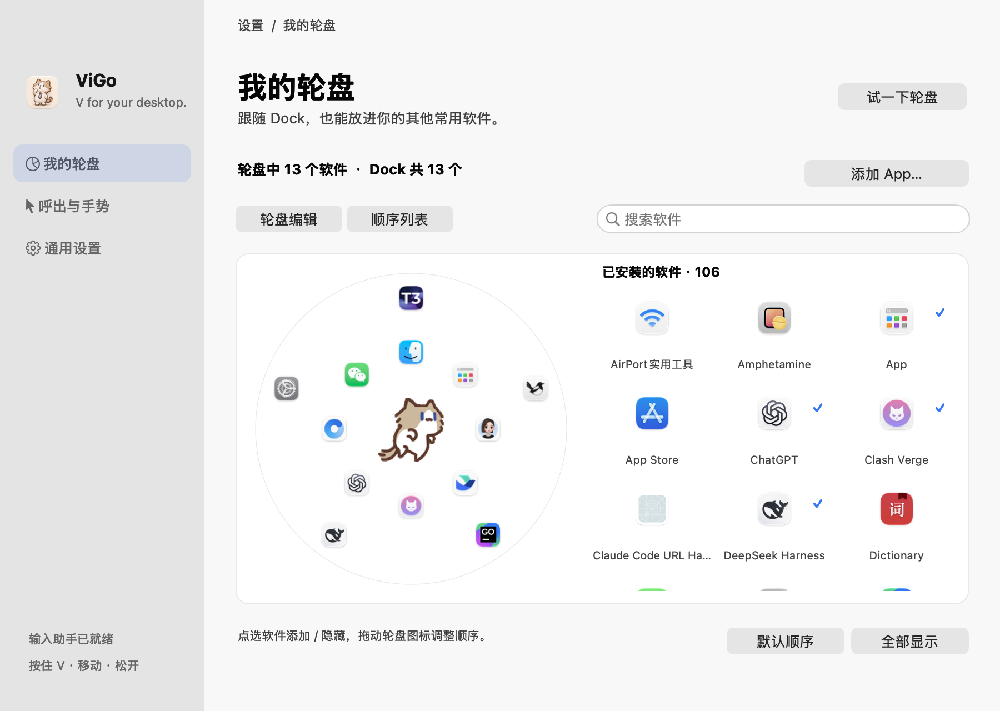

# ViGo

**按住 V，把常用软件放到手边。**

Rust + AppKit 原生 macOS 轮盘。自动跟随系统 Dock，也能手动添加软件、隐藏项目和调整顺序。

[下载 macOS 安装盘](https://github.com/9Ashwin/ViGo/releases/latest/download/ViGo-macOS-arm64.dmg) · Apple Silicon（M 系列）

<p align="center">
  
</p>

- Dock 的固定、运行中及最近使用的软件自动同步，不需要点同步；默认使用 Dock 顺序，手动调整后优先保留你的顺序。
- 设置恢复“我的轮盘 / 呼出与手势 / 通用设置”三页：左侧轮盘预览、右侧已安装软件图库，支持中文名称或英文包名搜索；点选添加/隐藏，拖动轮盘图标交换位置。
- 软件图库支持直接拖到左侧轮盘，拖动时显示落点；已有软件换位，新软件插入，拖到轮盘中心追加到末尾。取消拖动不改变配置，也不会把应用文件复制到桌面。
- 支持通过系统 App 选择器多选添加软件，不在 Dock 中的软件也会保留；顺序列表可勾选显示、上移/下移、移除手动添加的引用。隐藏记录、手动软件和顺序都会保存，重启后保留。
- “默认顺序”恢复 Dock 优先、手动添加接在后面的排序；“全部显示”恢复隐藏项。这些操作不修改系统 Dock，也不删除实际应用。
- 所有已选软件一次显示，不限 24 个，也不分组翻页。主轮盘保持紧凑，前 8 项在内环，其余顺序排到外圈，必要时增加外圈；边缘自动避让。
- 选中目标按软件身份保持；Dock 实时变化时重排，目标被删除则取消，避免松手切错。
- 轮盘只显示软件，松手直接启动或切换；支持台前调度。
- 轻按 V 正常输入，⌘V 等组合键保持原行为；长按约 150 毫秒呼出，回到中心、原呼出位置附近、Esc 或右键取消。
- 镂空轮盘保留桌面留白；单条遛猫绳风格的细织带跟随鼠标，接近软件时吸附，回到中心时收回；带轻微绳纹和小提环。
- 选中软件以轻微放大、抬起和圆形玻璃反馈；支持的触控板会有一次轻微对齐触感。系统“减少动态效果”开启时使用即时反馈。
- 中心小猫使用原始多帧图集，带方向、待机及轻微跟随反馈；停留时放缓，隐藏后停止绘制。
- 菜单栏保留启用/暂停、试用、设置、权限与诊断等入口；呼出键、轮盘尺寸、明暗外观和登录启动集中在设置。设置窗口默认 900 × 640，打开时显示 Dock 身份，关闭后释放窗口并回到菜单栏待命。

外圈只承接放不下的软件。文件夹、文件、废纸篓和分隔线不进入轮盘；不读取浏览器标签，不展示窗口或标签列表。

## 设置界面

左侧轮盘预览、右侧软件图库；支持添加 App、隐藏恢复和拖动排序。

<p align="center">
  
</p>

## 安装与更新

1. 打开下载的 DMG，把左侧 `ViGo.app` 拖到右侧“应用程序”文件夹。
2. 更新前先从菜单栏退出旧版，再拖入并选择“替换”；从 `/Applications/ViGo.app` 启动，避免保留“ViGo 2”副本。
3. 首次启动按引导开启辅助功能，随后按住 V 即可使用。

直接从安装盘或下载目录启动新包时，ViGo 也提供安装提示：先校验完整性和签名，再更新固定路径并启动；已有同版时使用已安装版本。没有写入权限时会引导使用访达的标准安装流程。安装错误会保留旧版本，准备期间不会修改它。

小猫图标由 Apple `iconutil` 从完整尺寸图集生成，并在启动时显式设置、按版本重新登记。安装盘附带应用程序快捷方式与操作说明。

## 权限与更新

仅需要辅助功能识别全局按键、读取 Dock 和切换软件。不捕获窗口画面，不请求屏幕录制。

未授权时，启动会自动显示辅助功能引导；点击引导按钮后由 macOS 登记授权请求并打开正确设置页。选择稍后不会反复打扰；已授权时不弹引导。授权后输入监听会自动恢复，无需重启；运行中撤销权限则停止监听并重新提示一次。

本机更新沿用固定签名、应用 ID `com.vigo.desktop` 和安装路径 `/Applications/ViGo.app`，已验证保留授权身份。公开下载包为 ad-hoc 签名、未公证，安装或更新后 macOS 仍可能要求重新授权；首次系统同意需要手动完成。

按住 V 没反应时，先在菜单栏确认 ViGo 已启用、呼出键为 V，并查看权限/监听状态。监听使用当前用户会话，不依赖 HID 底层位置；只有键盘事件已订阅且监听已启用才显示就绪。菜单中的“复制诊断信息”可提供版本、系统、芯片、权限、监听及安全键盘输入状态，不包含输入内容或软件列表。若提示安全键盘输入开启，请先离开密码框，或检查终端的安全键盘输入选项。

旧自定义列表不再导入，迁移前保存在 `~/Library/Application Support/ViGo/settings.before-dock.json`。新配置保存呼出和显示偏好、手动软件、隐藏记录及排序，系统 Dock 始终只读。

## GitHub Actions

[Native builds](https://github.com/9Ashwin/ViGo/actions/workflows/build.yml) 在 push、PR 和手动触发时执行格式、测试、Clippy，并生成 macOS Apple Silicon DMG、开发用 ZIP 与 SHA-256 校验值。安装盘还会挂载核验里面的应用签名、图标尺寸、快捷方式和布局。产物在运行页的 Artifacts 保留 14 天。

CI macOS 包使用 ad-hoc 签名，未公证，用于测试分发；macOS 本机覆盖更新继续使用固定 Apple Development 身份，CI 不上传本机私钥。旧 Electron 版本保留在 [`v0.2.1-electron`](https://github.com/9Ashwin/ViGo/tree/v0.2.1-electron)，`main` 为 Rust 原生版本。

## macOS 开发

需要 macOS 13+、Rust、Xcode 命令行工具和本机有效的 Apple Development 签名身份；本机已验证 Apple Silicon。macOS 26+ 使用系统玻璃，旧系统回退原生毛玻璃。

```sh
cargo test
cargo fmt --check
cargo clippy --all-features -- -D warnings
sh tools/native/bundle.sh
sh tools/native/install.sh
sh tools/native/dmg.sh
```

产物为 `release/native/ViGo.app`。安装脚本退出旧进程、保留旧包备份后替换，重新登记应用并刷新该应用的 Spotlight 元数据。图标资源名随内容哈希更新，避免复用旧图标缓存。可用 `VIGO_SIGN_IDENTITY` 指定固定签名身份。

正常构建不包含开发诊断入口，运行不依赖 Electron、Node 或 WebView。Dock 查询在独立工作中执行，空闲不绘制轮盘。

## 占用与平台边界

Apple Silicon / macOS 27 本机实测：0.5.3 本机压缩包约 5.4 MiB，安装约 6.0 MiB；待机物理 footprint 抽样约 15.5 MiB，12 个软件的轮盘打开时约 163 MiB，关闭 2 秒后约 59 MiB（按主进程及其子进程合计抽样）。图标、原生玻璃和绘图缓存会使占用变化，以上不是最大值承诺。旧 macOS 及多显示器尚需对应设备验证。


## 许可

代码采用 MIT 许可，保留第三方版权见 [THIRD_PARTY_LICENSES.md](THIRD_PARTY_LICENSES.md)。Rust 依赖许可随包附带，美术素材说明见 [assets/README.md](assets/README.md)。
